<p align="center">
  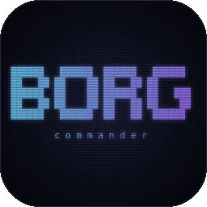
</p>

<pre align="center">
██████╗  ██████╗ ██████╗  ██████╗
██╔══██╗██╔═══██╗██╔══██╗██╔════╝
██████╔╝██║   ██║██████╔╝██║  ███╗
██╔══██╗██║   ██║██╔══██╗██║   ██║
██████╔╝╚██████╔╝██║  ██║╚██████╔╝
╚═════╝  ╚═════╝ ╚═╝  ╚═╝ ╚═════╝
c o m m a n d e r
</pre>

<p align="center">
  <strong>A two-panel file manager with your shell built in.</strong><br>
  macOS &amp; Linux · Bash, zsh &amp; fish
</p>

<p align="center">
  <a href="https://github.com/0xcd21h/borg-commander/releases/latest">Download</a> ·
  <a href="#install">Install</a> ·
  <a href="https://0xcd21h.github.io/borg-commander/">Website &amp; guide</a> ·
  <a href="DEVELOPMENT.md">Development</a>
</p>

<p align="center">
  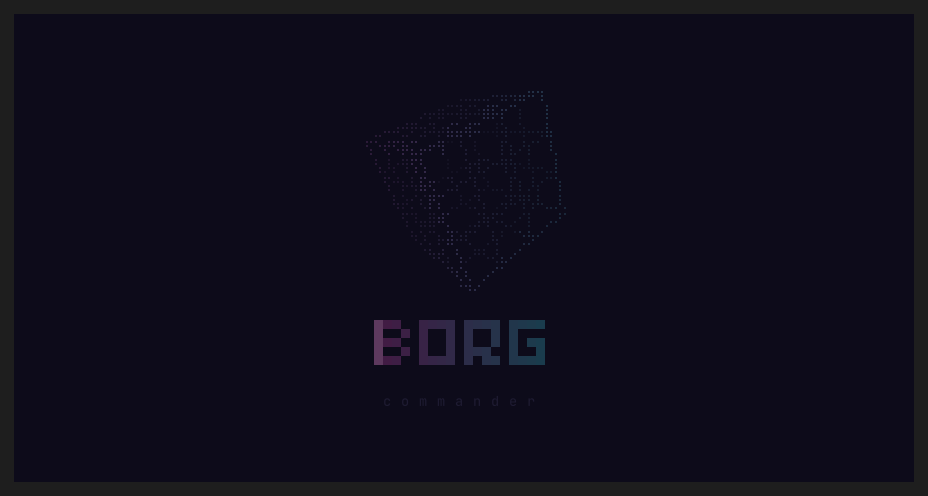
</p>

<p align="center"><em>Resistance is futile.</em></p>

## Why Borg

There have always been good terminals and good file managers. Programs that are both are rare:
two file panels with your shell running underneath, one Ctrl-O away. Norton Commander made that
layout famous on DOS. Volkov Commander, DOS Navigator, FAR Manager and Midnight Commander kept it
going, but most of them stayed in the DOS and Windows console era.

Borg Commander is a direct continuation of those projects for current macOS and Linux. It keeps
the keys you remember: F3 views, F4 edits, F5 copies, F6 moves, and Ctrl-O switches between the
panels and your bash, zsh or fish. On top of that it brings Git, Docker, remote sessions and
access for Claude and other agents into the same two panels.

## Install

```sh
curl -fsSL https://raw.githubusercontent.com/0xcd21h/borg-commander/main/scripts/install.sh | sh
```

The installer verifies the checksum, puts `borg` in `~/.local/bin` (or `/usr/local/bin` as
root), adds it to your PATH if needed, and starts it. In a terminal it also asks whether borg
should start at boot as a service, which keeps sessions running with no terminal open. That is
optional and the default answer is n; `BORG_SERVICE=1` sets it up without the question, and
F9 → Remote → **Background service…** sets it up later. Update with `borg update`: open sessions move to the new version and keep their shells. Binaries for
**macOS** (Apple Silicon or Intel) and **Linux** (ARM64 or x86-64) are on
[Releases](https://github.com/0xcd21h/borg-commander/releases/latest).

[Controls, settings, and source installation →](docs/GUIDE.md) ·
[Build, test, and contribute →](DEVELOPMENT.md)

## What you can do with it

- **Two-Panel File Manager with an Embedded Shell.** Your own bash, zsh or fish keeps its history and completion, and Ctrl-O shows the whole console.
- **Disk Usage Analyzer.** Alt-I sizes folders while you browse, Alt-Shift-D shows the largest branches first, and Alt-D finds every heavy folder such as `node_modules`.
- **Search and Replace Across Files.** Ctrl-F searches names and contents below a folder, F4 opens a hit at the match, and Ctrl-R replaces the text in every file found.
- **Viewer, Hex Viewer and Editor.** F3 shows code, Markdown, images and hex, and F4 edits with syntax highlighting, find and replace.
- **Resumable Background Copy.** Copies and moves of large trees run as jobs with progress, pause and conflict handling, and a cancelled copy run again skips what is already there.
- **Process Monitor and Memory Inspector.** Alt-M sorts processes by CPU, memory or disk, Enter opens a process's memory map and open files, and K sends it a signal.
- **Network Monitor and Packet Capture.** Alt-N lists listening ports with who can reach them and traffic per process, and R captures packets.
- **Startup and Persistence Audit.** Alt-U lists launch agents, systemd units, cron jobs, shell startup files and SSH keys, newest change first.
- **Linux Threat Detection.** A watcher checks every program start, flags a shell started by a web server or a program run from `/tmp`, and can freeze it until you decide.
- **Docker Dashboard.** Alt-C lists Compose projects with live CPU and memory, and opens a container's files in a panel or a shell inside it.
- **MCP Server for Claude.** Pair once, and Claude on your computer works on any of your machines through Borg, which asks before every change.
- **Remote Control Without Open Ports.** Drive your servers from your laptop: remote panels and live mirrors go through an end-to-end encrypted relay.

## Borg and a plain shell

The same jobs, done once in a plain shell and once in Borg. Shell keys count every character of
the commands an experienced admin types, plus Enter.

| Job | Plain shell | Borg | Shell keys | Borg keys |
| --- | --- | --- | ---: | ---: |
| Free disk space taken by core dumps and old ISOs | `du -d1 \| sort -h` folder by folder, `ls`, `rm` | Alt-Shift-D, mark, F8 | 223 | 33 |
| Find a launch agent and an SSH key that should not be there | `ls`, `plutil -p`, `crontab -l`, `cat`, `sed -i` | Alt-U, F3 to read, delete from the panel | 302 | 16 |
| Stop a runaway process and delete the log it fills | `ps \| grep`, `lsof -p`, `kill`, `rm` | Alt-M, filter, its open files, F8, K | 88 | 26 |
| Finish a copy you cancelled halfway | `rsync -a` with the same paths again | F5 again, skip what is already there | 101 | 62 |

## Claude in any terminal

Open borg on a server, in a container, or in a terminal in your browser, and Claude on your
computer works there with you. Borg connects out to borg cloud, a relay, so the machine needs
no open port, no SSH key and no public address. Firewalls and NAT stay as they are.

- **Pair once.** F1 then C shows a link. Run `borg pair` with it on your computer and approve
  the computer in borg. Claude Code then reaches that borg whenever it is open.
- **Claude sees what you see.** The screen, both panels, the console and what is typed at the
  prompt. It reads files, folders, processes, containers, startup items and the network's ports
  and connections, and shows you files in a panel.
- **You approve every change.** Commands, new files and edits wait in a dialog that shows the
  whole command or the diff. For a paired computer, Approve all can temporarily accept its
  changes for one session until you turn it off or disconnect. Commands run in your console, where you watch them and answer
  prompts such as sudo's.
- **Files both ways.** `borg get` and `borg put`, or Claude's download and upload tools, copy
  files between the server and your computer. Uploads wait for your approval.
- **Help at the prompt.** Claude can type a command at your prompt, or a script into vim or
  nano, for you to check and run yourself.

`borg sessions` manages named workspaces, and with more than one, `borg` starts with a window to
open, create or remove them. The first `borg` starts a background service that keeps borg cloud
connected for every Borg on the machine, and `borg service keep NAME` keeps a session running with
no terminal. `borg service install` and `enable` start the service at boot.
Open a workspace with `borg --session NAME`, or one the service keeps with
`borg service attach NAME`; Ctrl-] detaches. One `borg mcp` connection can list and select local
or paired targets. `borg --remote MACHINE:SESSION` opens a paired session's filesystem in a local
panel with F5 copies to and from local folders, and `borg mirror MACHINE:SESSION` shows its live screen in the local terminal.
Regular sessions can be mirrored while Borg is running, without a background service.
The mirror displays its control status; Ctrl-T takes control from a view-only mirror, and Ctrl-G exits.
In Remote hosts (Alt-H), U updates a paired host, and a mirror of it reconnects once the host is back.

**Why the connection cannot be taken over.** Each borg holds its own key. Pairing exchanges
the keys through a link that only your screen shows, and you confirm in borg that both
screens show the same pairing code, six emoji with their names. Every connection then opens with a Noise handshake bound to those keys,
and everything after it is encrypted from one borg to the other. The relay forwards bytes it
cannot read. Whoever runs the relay, or breaks into it, can neither read nor change the
traffic, nor answer in either borg's name: the private keys never leave the two machines.

**Fair use.** borg cloud is a free relay shared by everyone who uses borg. It carries borg's
traffic only, within limits on bandwidth and connections, and it may change or stop without
notice. Use it for machines you own or are allowed to work on. To keep the relay under your
own control, [run your own](docs/GUIDE.md#running-a-relay).

## Files and a real shell

Keep two folders side by side and type commands at the prompt below. Borg runs your
Bash, zsh, or fish session, with its history, completion, and multiline editing.
Ctrl-O switches between the panels and the console.

<p align="center">
  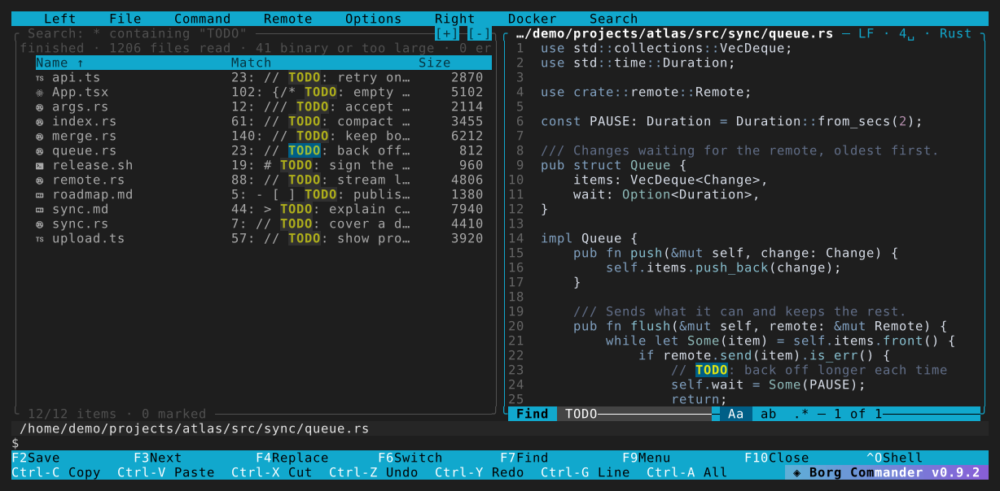
</p>

- **Move files while you keep browsing.** Copy, move, and delete in background jobs,
  with progress, pause, and conflict handling. Mark a few files or select a whole pattern.
- **Look inside without leaving the folder.** Preview highlighted code, formatted Markdown,
  and images. Scroll a document in quick preview, expand it into the viewer, and keep your place.
  Large text files load around the visible page. Binary files open as hex rows, and H switches any
  file between hex and text.
- **See Git beside your files.** Branch names and file status in the panels; diffs, recent
  commits, staging, and unstaging in the Git menu. The bundled plugin can be switched off.
- **Edit in a panel.** F4 opens Borg's editor with highlighting, find and replace, undo, and
  mouse selection. Alt-E puts it inside a panel, beside its folder or another file. From search
  results it opens in the other panel at the match, and the list stays in view.
- **Use the mouse or stay on the keys.** Click menus, select files, and scroll previews.
  Familiar function-key actions also work with Esc followed by a digit.
- **Jump to any folder.** Type `cd ` and pick from your hotlist and recent folders right above
  the prompt. Type a path and its subfolders appear, narrowing as you type, in `cd` and in any
  other command. Ctrl-\ opens the whole list, and a typed `cd` moves the panel without flashing
  the console.

<p align="center">
  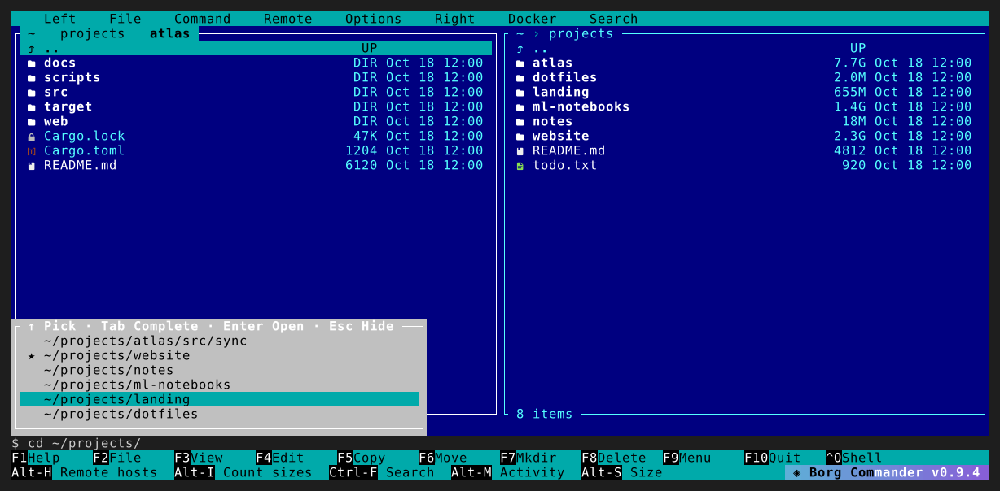
</p>

## Find what takes space

<p align="center">
  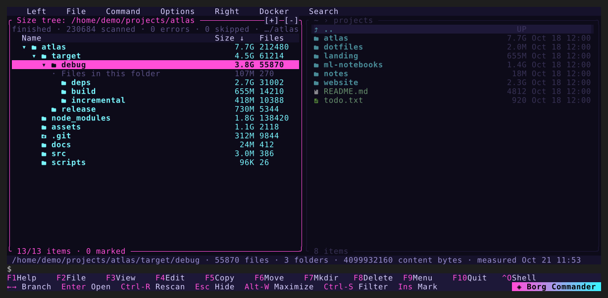
</p>

- **Sizes while you browse.** Alt-I measures every folder below the current one in the
  background. Totals fill in as they finish, and you can keep navigating or typing commands.
- **A size tree.** Alt-Shift-D opens the folder as a tree, largest branches first, with a
  row for the bytes stored directly in each folder.
- **Find the heavy folders.** Alt-D searches for folders over a size or file count, such as
  every `node_modules`, and lists them with their source paths. Mark them and delete with F8.
- **Measured once, shown again.** Finished scans are saved locally and reused by the panels,
  the tree, and the search, marked with the date they were measured. Ctrl-R rescans.

<p align="center">
  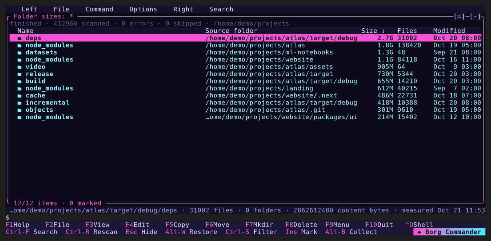
</p>

## Processes and memory

<p align="center">
  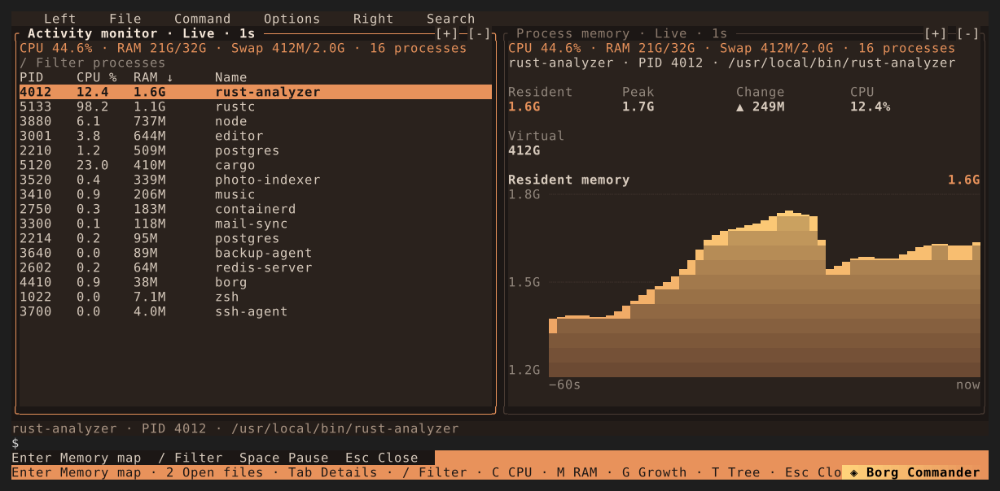
</p>

- **A live process list.** Alt-M shows CPU, RAM, memory growth, and disk rates, sorted by
  any column or as a tree. Above the list, a summary shows each core's CPU use, the load as a share
  of the cores, memory, swap, disk rates and the uptime. The other pane charts the selected
  process's memory over the last minute.
- **Signals and priority.** K sends Terminate, Kill, Stop, Continue and the other common signals,
  or changes the priority. A process that belongs to someone else takes the administrator's password.
- **Where the memory goes.** Enter opens the process's memory map, grouped by purpose and
  ranked by **footprint**: the memory charged to that process alone, separate from shared
  libraries that only make it look large.
- **Look inside.** Preview any readable region as hex or text, compare two captures, search a
  process's memory for text or bytes, and list its open files. Administrator access is only
  requested when you ask for it.
- **What starts on its own.** Alt-U lists launch agents and daemons, systemd units and timers,
  cron jobs, shell startup files and SSH keys in one list, newest change first, with the program
  each one runs, whether that program is there, and the rules it matched.
- **Watch what starts.** On Linux, turn on Watch in Options and `borg service start` keeps an eye
  on every process that begins: a shell opened by a web server, a program running from `/tmp` or
  from a deleted file, a forced library, a run of commands looking around the machine. Borg learns
  what is normal here for a week first, then freezes what it is sure about, which stops the
  process where it is without giving a supervisor anything to restart. Alt-L lists the alerts with
  the evidence, and C, K or A lets it go on, ends it, or allows that start for good.

<p align="center">
  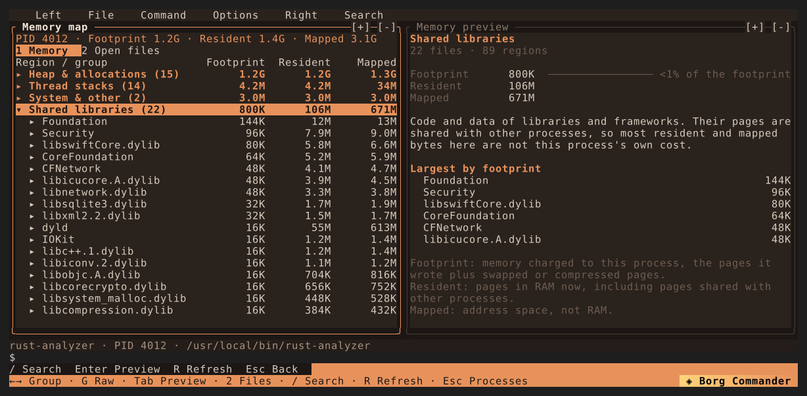
</p>

## Network

<p align="center">
  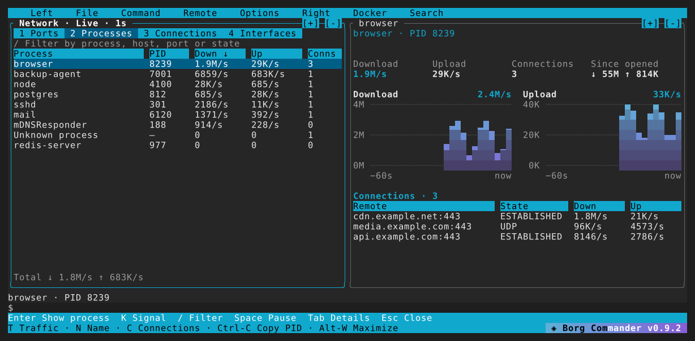
</p>

- **Every open port and who can reach it.** Alt-N lists the ports your processes listen on and
  says who can connect to each one: all networks, one address, or only this machine.
- **Traffic by process.** Download and upload rates for each process, connection and interface,
  with charts of the last minute and the names of the hosts on the other end.
- **Who else is on the network.** The Neighbors page lists the devices next to this machine with
  their MAC addresses, vendors and names, marks the gateway, and flags a gateway whose MAC address
  changes or one MAC address answering for several addresses. S scans the subnet with ping and
  ports 22, 80 and 443 after asking, and hosts that went offline stay listed with the time they
  were last seen. P scans one host's TCP ports in the background, fast or slow, and stops when the
  host or a firewall seems to limit the scan.
- **Straight to the culprit.** Filter with words such as `port:443`, `proc:node` or
  `!state:time_wait`. Enter shows the row's process in the activity monitor, and K signals it.
- **Look inside the packets.** R records the selected port, connection or process with tcpdump,
  which Borg offers to install with your package manager when it is missing, and runs as
  administrator after the system's password dialog when it needs to. The viewer sorts the packets
  by process, host and connection, down to each packet's layers and bytes. Each connection stays
  whole for its first 1 MiB and keeps only its headers after that, so a long download does not
  fill the file. On macOS an
  administrator capture tags every packet with its process. F3 opens `.pcap` files the same way.
  A capture can set `SSLKEYLOGFILE` in Borg's shell and keep the TLS keys of the programs you
  start, and an encrypted connection's stream then shows what it carried, also for programs that
  pin their certificates. Programs that never write their keys can go through Borg's own HTTPS
  proxy instead, signed by a CA made for that capture or by your development CA.

## Containers

<p align="center">
  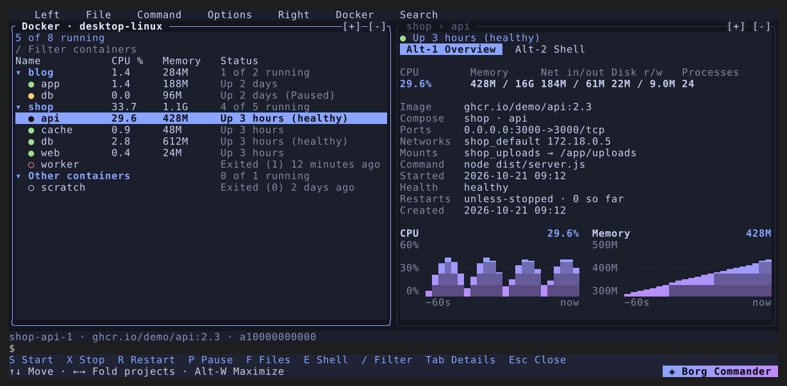
</p>

- **Your Compose projects at a glance.** Alt-C lists containers by project with live CPU and
  memory. S, X, R and P start, stop, restart and pause a container or a whole project.
- **Step inside.** F opens a container's files in a panel beside a host folder, and F5 copies
  either way. E opens a shell, and the command line follows you into the container.

## Themes

Six built-in themes, from Classic blue to Paper. Pick one from the menu or make your own.

| Midnight | Aurora |
| --- | --- |
| 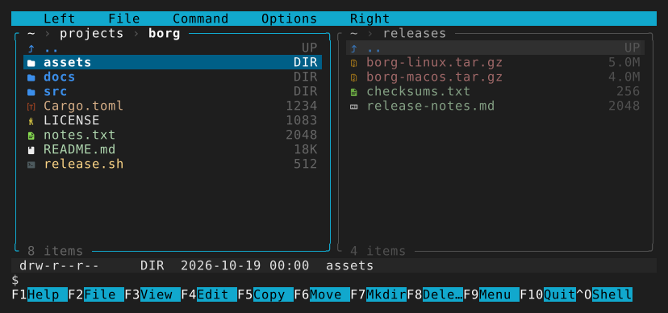 | 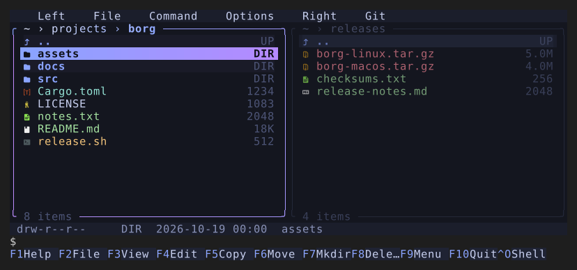 |
| **Neon** | **Classic** |
| 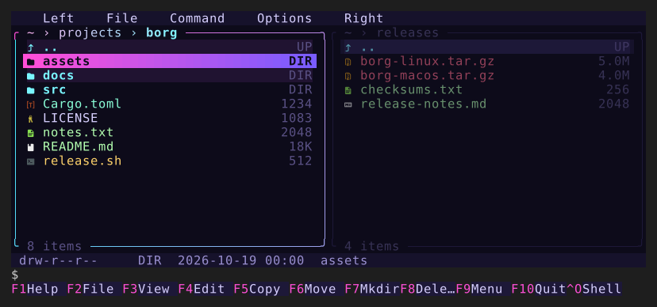 | 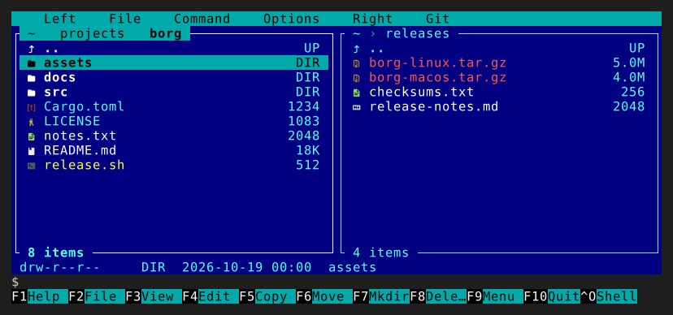 |
| **Paper** | **Ember** |
| 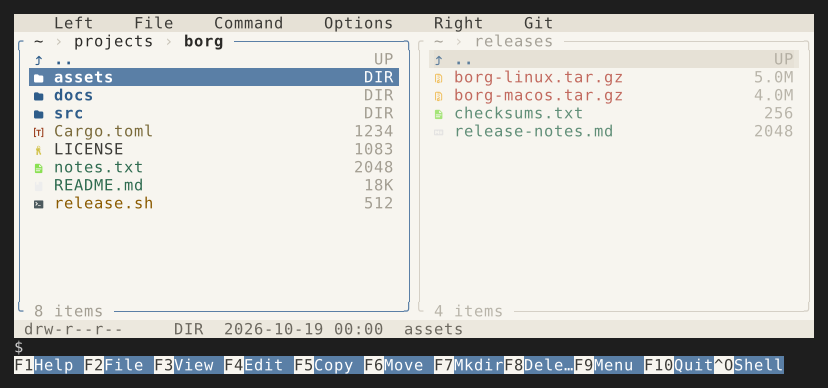 | 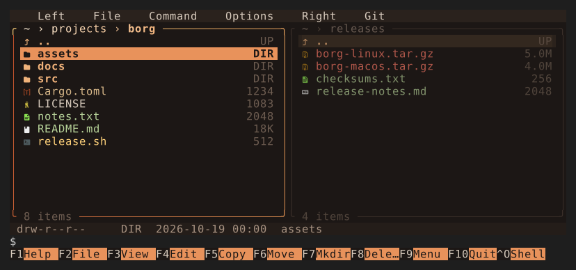 |

Every download includes **Borg Mono**, a font with file icons. Ghostty uses rich icons
automatically; other terminals start with portable symbols. [Font setup](fonts/README.md).

## License

Borg Commander is available under either the [MIT License](LICENSE-MIT) or the
[Apache License, Version 2.0](LICENSE-APACHE), at your option. Unless you say otherwise,
any contribution you submit is licensed the same way, without additional terms.

Screenshot rendering uses bundled DejaVu Sans Mono and Symbols Nerd Font.
The icon table comes from [nvim-web-devicons](https://github.com/nvim-tree/nvim-web-devicons)
through [yazi](https://github.com/sxyazi/yazi). Font and icon licenses are included in the repository.

Syntax definitions and highlighting themes come from [two-face](https://github.com/CosmicHorrorDev/two-face)
and [bat](https://github.com/sharkdp/bat); their licences are in [SYNTAX-LICENSES.md](docs/SYNTAX-LICENSES.md).
