<pre align="center">
██████╗  ██████╗ ██████╗  ██████╗
██╔══██╗██╔═══██╗██╔══██╗██╔════╝
██████╔╝██║   ██║██████╔╝██║  ███╗
██╔══██╗██║   ██║██╔══██╗██║   ██║
██████╔╝╚██████╔╝██║  ██║╚██████╔╝
╚═════╝  ╚═════╝ ╚═╝  ╚═╝ ╚═════╝
c o m m a n d e r
</pre>

<p align="center">
  <strong>A two-panel file manager with your shell built in.</strong><br>
  macOS &amp; Linux · Bash, zsh &amp; fish
</p>

<p align="center">
  <a href="https://github.com/0xcd21h/borg-commander/releases/latest">Download</a> ·
  <a href="#install">Install</a> ·
  <a href="docs/GUIDE.md">User guide</a> ·
  <a href="DEVELOPMENT.md">Development</a>
</p>

<p align="center">
  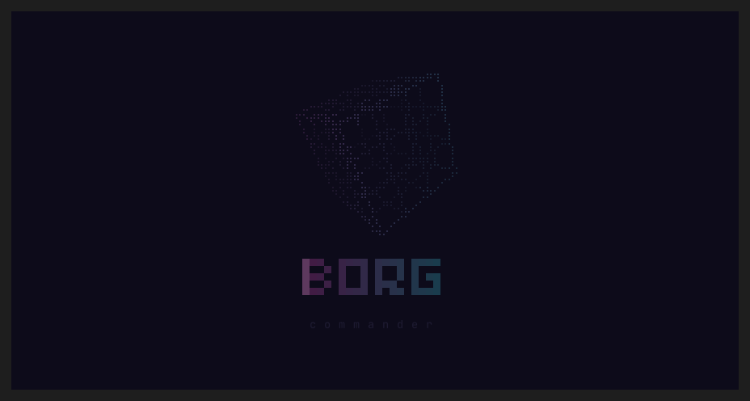
</p>

<p align="center"><em>Resistance is futile.</em></p>

## Files and a real shell

Keep two folders side by side and type commands at the prompt below. Borg runs your
Bash, zsh, or fish session, with its history, completion, and multiline editing.
Ctrl-O switches between the panels and the console.

- **Move files while you keep browsing.** Copy, move, and delete in background jobs,
  with progress, pause, and conflict handling. Mark a few files or select a whole pattern.
- **Look inside without leaving the folder.** Preview highlighted code, formatted Markdown,
  and images. Scroll a document in quick preview, expand it into the viewer, and keep your place.
  Large text files load around the visible page.
- **See Git beside your files.** Branch names and file status in the panels; diffs, recent
  commits, staging, and unstaging in the Git menu. The bundled plugin can be switched off.
- **Use the mouse or stay on the keys.** Click menus, select files, and scroll previews.
  Familiar function-key actions also work with Esc followed by a digit.

## Find what takes space

<p align="center">
  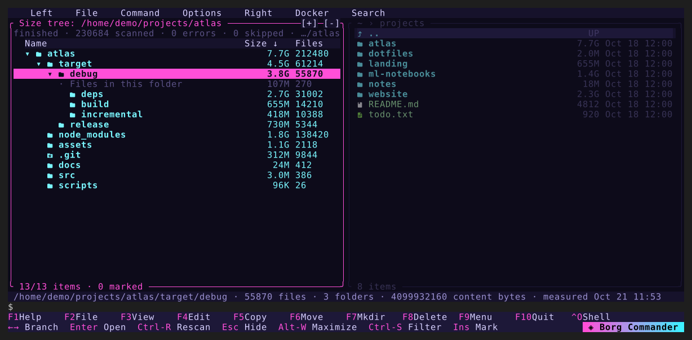
</p>

- **Sizes while you browse.** Alt-I measures every folder below the current one in the
  background. Totals fill in as they finish, and you can keep navigating or typing commands.
- **A size tree.** Alt-Shift-D opens the folder as a tree, largest branches first, with a
  row for the bytes stored directly in each folder.
- **Find the heavy folders.** Alt-D searches for folders over a size or file count, such as
  every `node_modules`, and lists them with their source paths. Mark them and delete with F8.
- **Measured once, shown again.** Finished scans are saved locally and reused by the panels,
  the tree, and the search, marked with the date they were measured. Ctrl-R rescans.

<p align="center">
  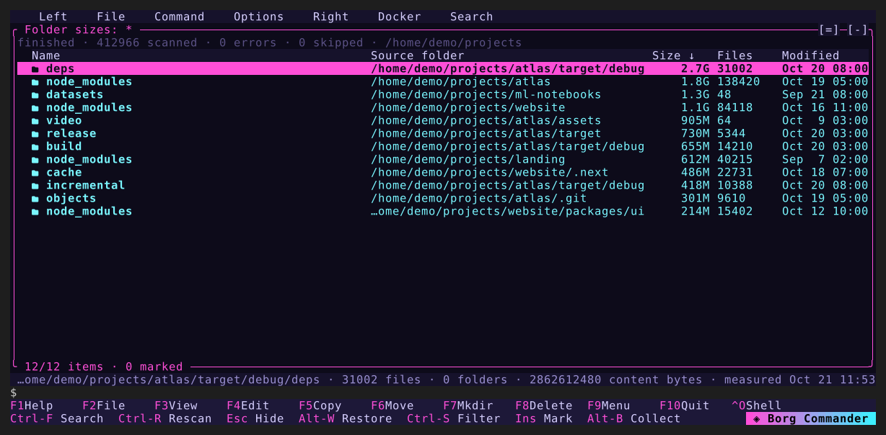
</p>

## Processes and memory

<p align="center">
  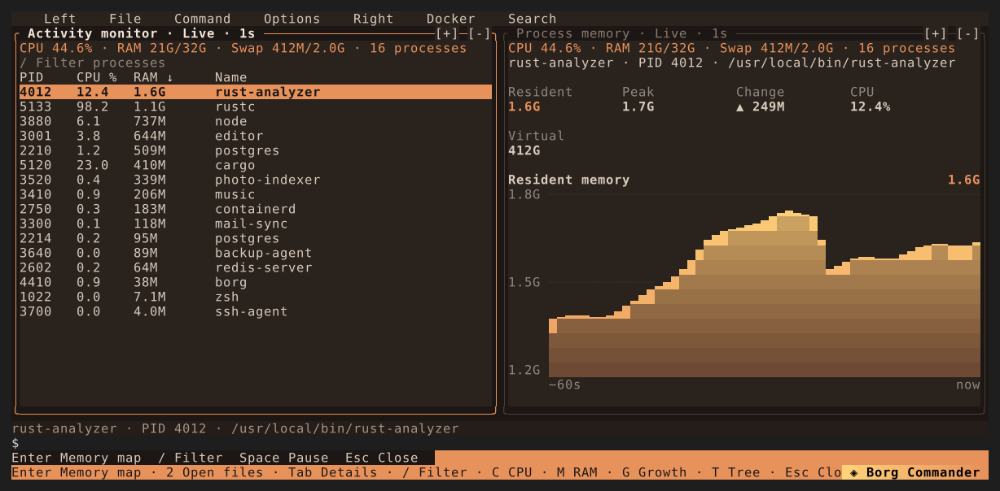
</p>

- **A live process list.** Alt-M shows CPU, RAM, memory growth, and disk rates, sorted by
  any column or as a tree. The other pane charts the selected process's memory over the last minute.
- **Where the memory goes.** Enter opens the process's memory map, grouped by purpose and
  ranked by **footprint**: the memory charged to that process alone, separate from shared
  libraries that only make it look large.
- **Look inside.** Preview any readable region as hex or text, compare two captures, search a
  process's memory for text or bytes, and list its open files. Administrator access is only
  requested when you ask for it.

<p align="center">
  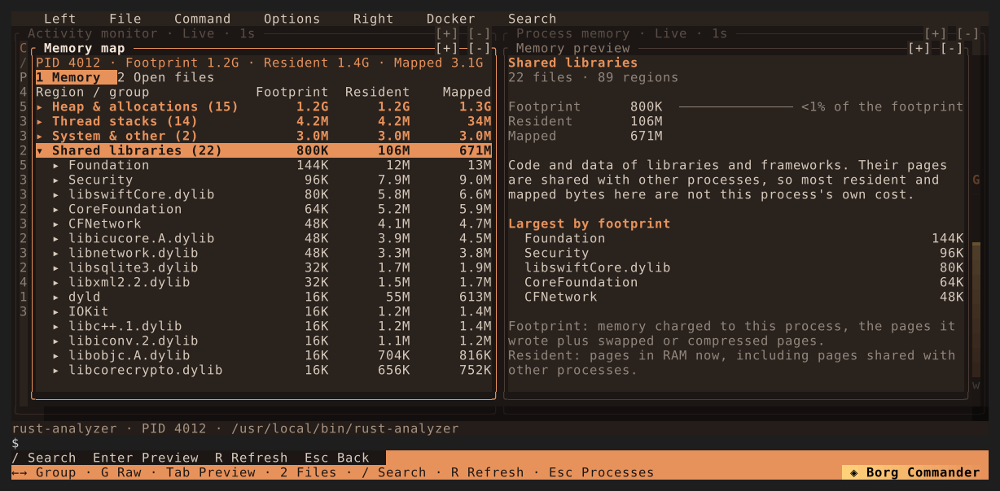
</p>

## Containers

<p align="center">
  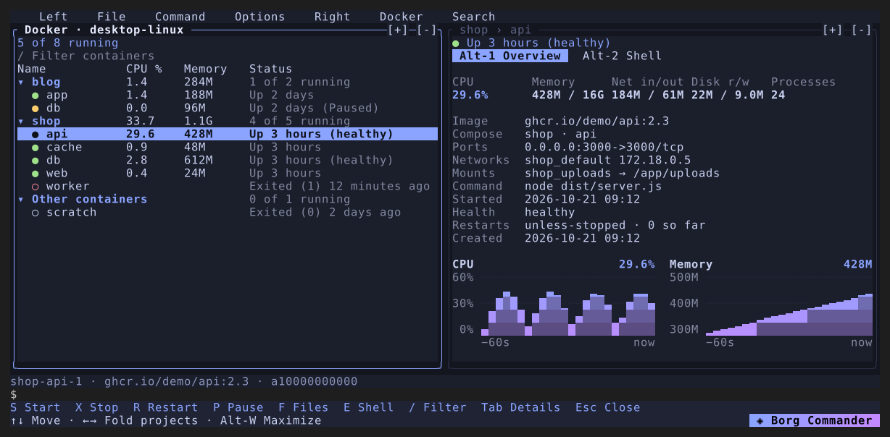
</p>

- **Your Compose projects at a glance.** Alt-C lists containers by project with live CPU and
  memory. S, X, R and P start, stop, restart and pause a container or a whole project.
- **Step inside.** F opens a container's files in a panel beside a host folder, and F5 copies
  either way. E opens a shell, and the command line follows you into the container.

## Themes

Six built-in themes, from Classic blue to Paper. Pick one from the menu or make your own.

| Midnight | Aurora |
| --- | --- |
| 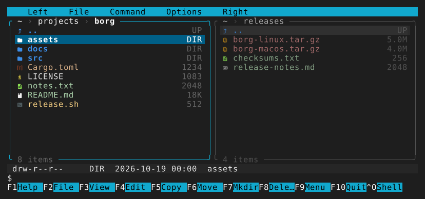 | 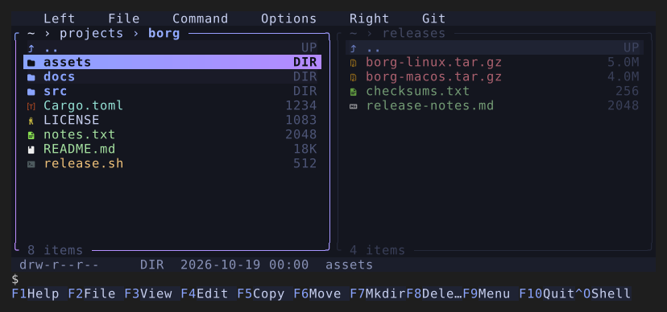 |
| **Neon** | **Classic** |
| 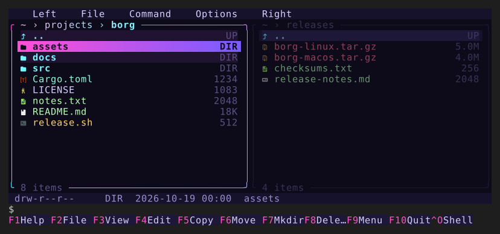 | 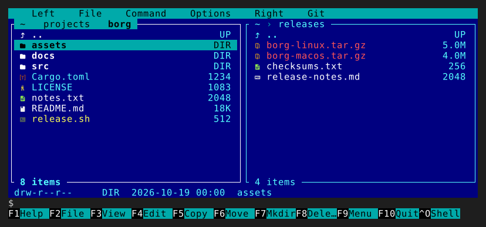 |
| **Paper** | **Ember** |
| 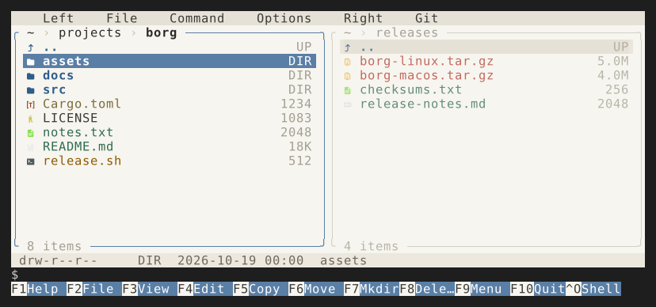 | 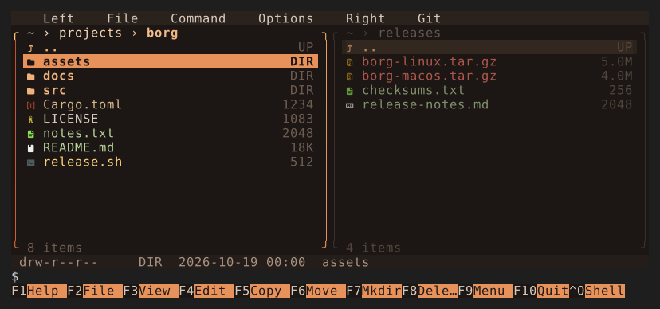 |

Every download includes **Borg Mono**, a font with file icons. Ghostty uses rich icons
automatically; other terminals start with portable symbols. [Font setup](fonts/README.md).

## Install

Download a binary for **macOS** (Apple Silicon or Intel) or **Linux** (ARM64 or x86-64)
from [Releases](https://github.com/0xcd21h/borg-commander/releases/latest), or use the installer:

```sh
curl -fsSL https://raw.githubusercontent.com/0xcd21h/borg-commander/main/scripts/install.sh | sh
```

Run `borg` in any folder. The installer verifies the checksum and puts the binary in
`~/.local/bin`. Update with `borg update`.

[Controls, settings, and source installation →](docs/GUIDE.md) ·
[Build, test, and contribute →](DEVELOPMENT.md)

## License

Borg Commander is available under either the [MIT License](LICENSE-MIT) or the
[Apache License, Version 2.0](LICENSE-APACHE), at your option. Unless you say otherwise,
any contribution you submit is licensed the same way, without additional terms.

Screenshot rendering uses bundled DejaVu Sans Mono and Symbols Nerd Font.
The icon table comes from [nvim-web-devicons](https://github.com/nvim-tree/nvim-web-devicons)
through [yazi](https://github.com/sxyazi/yazi). Font and icon licenses are included in the repository.

Syntax definitions and highlighting themes come from [two-face](https://github.com/CosmicHorrorDev/two-face)
and [bat](https://github.com/sharkdp/bat); their licences are in [SYNTAX-LICENSES.md](docs/SYNTAX-LICENSES.md).
